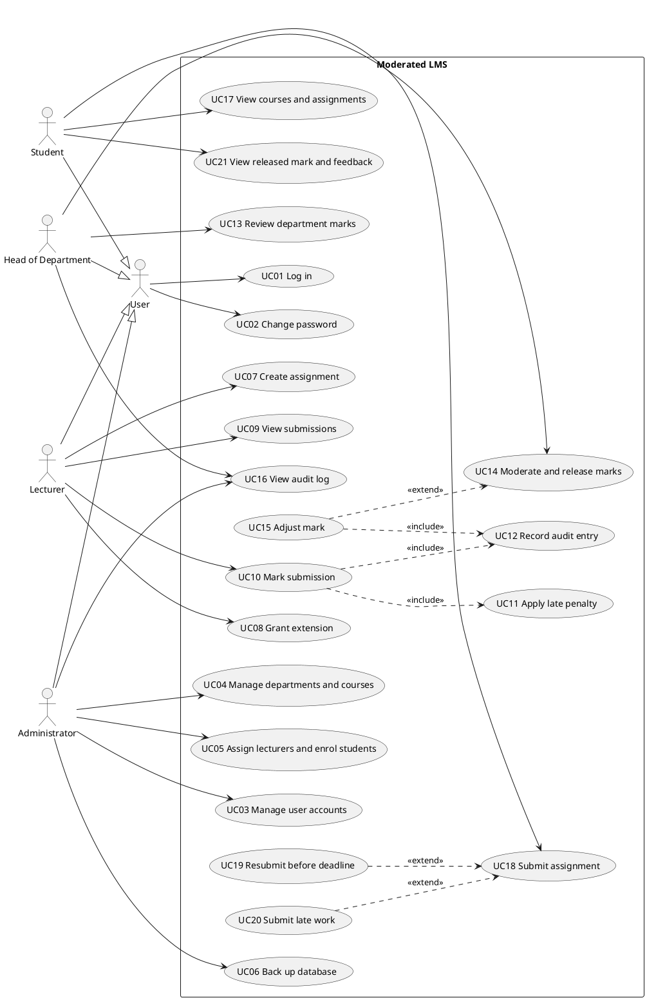

# Moderated LMS: Phase 2 Requirements Engineering (Draft)

This is the second part of the assignment: stakeholder analysis and conflict resolution (3 marks), SRS (5 marks) and use case model (6 marks). It is a draft for you to review, change and own. Several resolutions are **assumptions** that stakeholders would normally confirm; they are marked and listed at the end. Check them with your supervisor at Gate 1.

## 1. Stakeholder analysis

| Stakeholder | Role | Main interests and concerns | Influence |
|---|---|---|---|
| Principal | Sponsor, approves the system | Simple for non-IT teachers; students see no mark before HoD check | High |
| Lecturers | Direct user | Quick marking and release; ability to grant extensions | High |
| Heads of Department | Direct user | See and approve every departmental mark before release; late-penalty rule applied consistently | High |
| Students | Direct user | Submit, fix and resubmit; see marks and written feedback; late work not rejected | Medium |
| Student representative | Voice of students | Resubmission before deadline; written feedback; fair treatment of late work | Medium |
| System administrator | Direct user | Manage accounts, departments, courses, enrolments | Medium |
| IT officer | Operator | Offline operation, protected passwords, speed with 800 students, easy backup | Medium |
| Parents/guardians and data protection regulator | Indirect | Protection of learners' personal data and fair, accurate assessment records | Low to medium |

## 2. Conflicts and ambiguities, and how each was resolved

| # | Issue | Resolution | Reason |
|---|---|---|---|
| C1 | **Conflict.** Lecturer wants students to see marks once marked; Principal and HoD say not before HoD checks. | A student sees a mark only when its submission is **Released**. Lecturers mark immediately; the HoD sees marks as soon as they are saved and can release in one batch per assignment. | The Principal sponsors the system and the case study makes HoD moderation mandatory. Batch release recovers most of the speed the lecturer wants. |
| C2 | **Ambiguity.** Does the 10%-per-day penalty count from the original or the extended deadline? | From the student's **effective deadline**: the extension deadline if one exists, otherwise the assignment deadline (BR-1). | An extension would be pointless if the penalty still counted from the old deadline. |
| C3 | **Ambiguity.** "10% of the available mark": of the raw mark or of the maximum? "Each day": full days or started days? | Penalty = 10% of the assignment's **maximum mark** per **started 24-hour period** after the effective deadline, up to 3 periods; later than 72 hours gives zero. Weekends count (assumption). | Fixed amounts are predictable and testable; started periods avoid a loophole where 23 hours late is free. |
| C4 | **Conflict.** Student rep wants late work accepted; HoD wants zero after three days. | Late work is **always accepted and recorded**, flagged Late. After 72 hours it is accepted but scores zero, and still receives written feedback. | Satisfies "not simply rejected" while keeping the HoD's rule. |
| C5 | **Ambiguity.** May a student resubmit after the deadline? | Resubmission is allowed only **before** the effective deadline. A late first submission cannot be resubmitted (BR-7). | Keeps the penalty calculation unambiguous. The student rep asked only for resubmission before the deadline. |
| C6 | **Conflict.** Lecturer marks early, then the student resubmits. | A submission can be marked only **after** its effective deadline has passed (BR-8). | Avoids invalidating marks. Cost: marking cannot start before the deadline. |
| C7 | **Ambiguity.** Is written feedback mandatory? | Yes: non-empty feedback is required to mark a submission. | Student rep asked for feedback, not just a number. Confirm workload impact with the lecturers. |
| C8 | **Ambiguity.** "Simple" and "respond quickly" are not measurable. | Measurable NFRs: a first-time lecturer creates an assignment in 5 minutes using only the manual (NFR-08); login within 2 seconds with 800 students stored (NFR-01). | Case study requires non-functional requirements to be measurable. |
| C9 | **Ambiguity.** "800 students on it": stored or simultaneous? | 800 student accounts **stored**, with up to 5 simultaneous sessions supported (assumption to confirm with the IT officer). | The case study says a single computer or local network, and SQLite is not built for heavy concurrent writes. |
| C10 | **Gap.** Who may change a mark, and when? | Lecturer before moderation; HoD during moderation and after release. Every change needs a reason and an audit entry (FR-13). | Case study requires who, when and why for all mark changes. |
| C11 | **Gap.** Can one person hold two roles (HoD who also teaches)? | Each account has exactly **one role** (BR-9). | Avoids a HoD moderating their own marking. |

## 3. Software Requirements Specification (ISO/IEC/IEEE 29148 structure)

### 3.1 Introduction
**Purpose.** To specify the requirements of the Moderated Learning Management System (LMS) for a secondary school. **Scope.** Courses, assignments, submissions, marking, HoD moderation and release of marks, for four roles. **Out of scope (Won't have):** online payment, video conferencing, automated grading, plagiarism detection, web and mobile interfaces, notifications by email. **Definitions.** *Effective deadline*: the student's extension deadline if granted, otherwise the assignment deadline. *Raw mark*: lecturer's mark before penalty. *Final mark*: raw mark minus penalty. *Released*: visible to the student.

### 3.2 Overall description
A C++17 console application using SQLite, running offline on one school computer or a local network. User classes: Student, Lecturer, HoD, Administrator. Constraints: no internet dependency, salted password hashes, all data access through a data-access layer. Assumptions: the school computers meet the reference hardware (dual-core, 4 GB RAM); user accounts are created only by the Administrator.

### 3.3 Business rules

| ID | Rule |
|---|---|
| BR-1 | Effective deadline = extension deadline if one exists for that student and assignment, else assignment deadline. |
| BR-2 | A submission is on time if submitted at or before the effective deadline. Otherwise days late = ceil((submission time - effective deadline) / 24 hours). |
| BR-3 | Penalty = 10% of assignment maximum mark x days late for 1 to 3 days. More than 3 days: final mark is 0. |
| BR-4 | Final mark = max(0, raw mark - penalty), rounded half up to 2 decimal places. Example: maximum 20, raw 16, 2 days late: penalty 4, final 12. |
| BR-5 | Submission life cycle: **Submitted** or **Late** (on arrival) -> **Marked** (lecturer) -> **Moderated** (HoD approves) -> **Released** (HoD releases). No other transitions. |
| BR-6 | All versions of a submission are kept; the latest is the one marked. |
| BR-7 | Resubmission is allowed only while state is Submitted and the effective deadline has not passed. A Late submission cannot be resubmitted. |
| BR-8 | A submission can be marked only after its effective deadline has passed. |
| BR-9 | Each account has exactly one role. A lecturer sees only assigned courses; a HoD only their department; a student only own enrolled courses. |
| BR-10 | Any mark change or extension requires a reason of at least 5 characters. |

### 3.4 Functional requirements
Priority is MoSCoW. Source: P Principal, L Lecturer, H HoD, S Student rep, I IT officer, C case study. Verification: T test, I inspection, D demonstration.

| ID | Requirement | Pri. | Source | Ver. |
|---|---|---|---|---|
| FR-01 | The system shall authenticate a user by username and password and show only the functions allowed for that user's role. | Must | C, I | T |
| FR-02 | The administrator shall be able to create, edit and deactivate accounts for students, lecturers, HoDs and administrators, with unique usernames. | Must | C | T |
| FR-03 | The administrator shall be able to create and edit departments and courses; each course belongs to exactly one department. | Must | C | T |
| FR-04 | The administrator shall be able to assign lecturers to courses and enrol students in courses. | Must | C | T |
| FR-05 | A lecturer shall be able to create an assignment for an assigned course with a title, description, deadline and maximum mark (1 to 1000). | Must | C | T |
| FR-06 | A student shall be able to view enrolled courses and their assignments with deadlines and own submission status. | Must | C | T |
| FR-07 | A student shall be able to submit a file (up to 5 MB); the system shall record the timestamp and set the state to Submitted, or Late if after the effective deadline. | Must | C | T |
| FR-08 | A student shall be able to resubmit before the effective deadline; the system shall keep all versions and mark the latest. | Must | S, C | T |
| FR-09 | The system shall accept submissions after the effective deadline and flag them Late; it shall never reject work only for lateness. | Must | S | T |
| FR-10 | A lecturer shall be able to grant an individual student an extension (new deadline and reason) for an assignment. | Must | L | T |
| FR-11 | The system shall calculate late penalties and final marks according to BR-1 to BR-4. | Must | H | T |
| FR-12 | A lecturer shall be able to list submissions for own assignments and mark one by entering a raw mark (0 to maximum) and non-empty written feedback; the system shall show raw mark, penalty and final mark. | Must | L, S, C | T |
| FR-13 | The system shall record every mark change in an audit log: who, when, old value, new value and reason. | Must | C | T, I |
| FR-14 | A HoD shall be able to view all marks, feedback and statuses for courses in their own department only. | Must | H | T |
| FR-15 | A HoD shall be able to approve marked submissions (state Moderated) or adjust a mark with a reason before approving. | Must | H, P | T |
| FR-16 | A HoD shall be able to release moderated marks to students, individually or for a whole assignment; only Moderated submissions can be released. | Must | P, H | T |
| FR-17 | A student shall be able to view a mark and feedback only when the submission is Released. | Must | P | T |
| FR-18 | The system shall reject every action not permitted for the user's role and report it in plain language. | Must | C | T |
| FR-19 | A HoD shall be able to correct a Released mark with a reason; the student sees the corrected mark and the change is audited. | Should | H | T |
| FR-20 | A HoD and the administrator shall be able to view and filter the audit log by date, user and submission. | Should | C | D |
| FR-21 | A user shall be able to change their own password; the system shall lock an account for 5 minutes after 5 consecutive failed logins. | Should | I | T |
| FR-22 | The administrator shall be able to back up the database to a chosen folder and restore it. | Should | I | D |
| FR-23 | The system shall allow a lecturer to export a course's final marks to a CSV file. | Could | L | D |

### 3.5 Non-functional requirements

| ID | Requirement (measurable) | Pri. | Source | Ver. |
|---|---|---|---|---|
| NFR-01 | **Performance.** Login completes within 2 seconds with 800 student and 60 staff accounts stored, on reference hardware (dual-core, 4 GB RAM). | Must | I | T |
| NFR-02 | **Performance.** Listing a course's submissions (up to 150) and saving a mark each complete within 1 second. | Must | I | T |
| NFR-03 | **Offline operation.** All functions work with every network interface disabled. | Must | I | T |
| NFR-04 | **Password security.** Passwords are stored only as salted hashes (Argon2id via libsodium, unique salt of at least 16 bytes); no password appears in the database or logs. | Must | I | I, T |
| NFR-05 | **Injection safety.** All SQL statements are parameterised and issued only from the data-access layer (zero string-built queries). | Must | C | I |
| NFR-06 | **Robustness.** A set of at least 50 invalid inputs and simulated database failures causes zero crashes. | Must | C | T |
| NFR-07 | **Audit integrity.** 100% of mark changes produce an audit entry, and no function can edit or delete audit entries. | Must | C | T, I |
| NFR-08 | **Usability.** In a test with 3 first-time lecturers using only the manual, all complete "create assignment" within 5 minutes; a student submits work in at most 6 menu actions. | Must | P | T |
| NFR-09 | **Accessibility.** Every status and error is conveyed by text, never by colour alone, and all functions work with keyboard only. | Should | C | I |
| NFR-10 | **Concurrency.** Up to 5 simultaneous sessions do not corrupt data; conflicting writes are retried or reported. | Should | I | T |
| NFR-11 | **Maintainability.** At least 70% line coverage of the business-logic layer and no high-severity static analysis findings. | Should | C | T, I |
| NFR-12 | **Recoverability.** A technician restores a backup in under 15 minutes following the installation guide. | Should | I | D |

### 3.6 Deliberate scope choice for later maintenance
Version 1.0 does not show extensions on the student's assignment list and has no class-wide extension. Those are the content of change request CR1 (Phase 8), so leaving them out now keeps the maintenance phase meaningful.

## 4. Use case model

### 4.1 Use case diagram (PlantUML source)
Paste this into plantuml.com (or a PlantUML plugin) to render it, then export the image for your report. Generalisation: the four actors specialise an abstract *User*.

All use cases except UC01 require the user to be logged in (precondition). UC19 and UC20 extend UC18 only when the resubmission or late condition holds.

### 4.2 UC18 Submit assignment

| Field | Content |
|---|---|
| Actor | Student |
| Goal | Hand in work for an assignment, including resubmission and late submission. |
| Preconditions | Student is logged in and enrolled in the course; the assignment exists. |
| Trigger | Student selects "Submit work" for an assignment. |

**Main flow**
1. The system shows the assignment, its deadline and the student's current submission status.
2. The student gives the path of the file to submit.
3. The system validates the file: it exists, is readable, is not empty and is at most 5 MB.
4. The system finds the effective deadline (BR-1) and compares it with the current time.
5. The current time is not after the effective deadline, so the system stores the file as a new version, sets the state Submitted and records the timestamp.
6. The system confirms the version number and timestamp.

**Alternative flows**
- **A1 Resubmission (UC19), at step 1:** a Submitted version exists and the deadline has not passed. The system asks the student to confirm replacing it; on confirmation the flow continues at step 2. The earlier version is kept and the new one becomes current (BR-6).
- **A2 Late submission (UC20), at step 4:** no version exists and the deadline has passed. The system tells the student how many days late they are and what the penalty will be (a zero mark if over 72 hours). On confirmation it stores version 1 with state Late and continues at step 6.
- **A3 Cancel:** the student cancels at any step; nothing is stored.

**Exception flows**
- **E1** Student is not enrolled: the action is refused and no data changes.
- **E2** Invalid file (missing, unreadable, empty, over 5 MB): the system explains the problem and returns to step 2.
- **E3** State is already Late: resubmission is refused with an explanation (BR-7).
- **E4** State is Marked or later: submission is refused.
- **E5** Storage or database error: the transaction is rolled back, the student sees an error message and no partial version exists.

**Postconditions.** Success: a new version is stored, it is the current version, and the state is Submitted or Late with its timestamp. Failure: no change to stored data.

**Business rules.** BR-1, BR-2, BR-5, BR-6, BR-7.

### 4.3 UC10 Mark submission

| Field | Content |
|---|---|
| Actor | Lecturer |
| Goal | Record a mark and written feedback for a student's submission. |
| Preconditions | Lecturer is logged in and assigned to the course; the submission is Submitted or Late; its effective deadline has passed (BR-8). |
| Trigger | Lecturer selects a submission to mark. |

**Main flow**
1. The lecturer selects a course and assignment; the system lists its submissions with their statuses (UC09).
2. The lecturer selects a submission.
3. The system shows the current version, the days late and the penalty that will apply.
4. The lecturer enters a raw mark between 0 and the assignment maximum.
5. The lecturer enters written feedback.
6. The system validates both entries.
7. The system applies the late penalty (UC11) and shows raw mark, penalty and final mark.
8. The lecturer confirms.
9. The system saves the marks and feedback, sets the state Marked, and records an audit entry (UC12) with who, when, old value (none), new value and reason "initial marking".
10. The system confirms that the mark is saved and not yet visible to the student.

**Alternative flows**
- **A1 Re-mark:** the submission is already Marked. The lecturer changes the mark and gives a reason (BR-10); the system records an audit entry with the old and new values and the state stays Marked.
- **A2 Cancel:** nothing is saved.

**Exception flows**
- **E1** Mark outside 0 to maximum, or not a number: error shown, return to step 4.
- **E2** Feedback empty: error shown, return to step 5.
- **E3** Effective deadline not yet passed: the system refuses and shows the deadline (BR-8).
- **E4** State is Moderated or Released: lecturer refused; only the HoD can change it.
- **E5** Database error: rollback, error message, nothing saved and no audit entry.

**Postconditions.** Success: raw mark, penalty, final mark and feedback saved; state Marked; one audit entry written. Failure: no change.

**Business rules.** BR-3, BR-4, BR-5, BR-8, BR-10.

### 4.4 UC14 Moderate and release marks

| Field | Content |
|---|---|
| Actor | Head of Department |
| Goal | Check marks in the department, approve or adjust them, and release them to students. |
| Preconditions | HoD is logged in; at least one submission in a course of their department is Marked. |
| Trigger | HoD selects a course and assignment to moderate. |

**Main flow**
1. The system lists all submissions for the assignment with lecturer, raw mark, penalty, final mark, feedback and state.
2. The HoD reviews them.
3. The HoD approves one submission or all Marked submissions.
4. The system sets the state to Moderated and records who approved and when.
5. The HoD chooses "Release" for one or all Moderated submissions.
6. The system sets the state to Released and records the release time.
7. The system reports how many marks were released; students can now see them (UC21).

**Alternative flows**
- **A1 Adjust a mark (UC15), at step 3:** the HoD enters a new mark and a reason (BR-10). The system validates it, records an audit entry (UC12) and returns to step 3.
- **A2 Partial release:** the HoD releases only some Moderated submissions; the rest stay Moderated.
- **A3 Correct a released mark (Should):** the HoD enters a new mark and a reason for a Released submission; the system saves it, records an audit entry and the student sees the new mark.

**Exception flows**
- **E1** A submission is not yet Marked: it is skipped at approval and the HoD is told how many were skipped.
- **E2** The course is outside the HoD's department: access denied.
- **E3** Reason missing or under 5 characters, or the new mark is out of range: rejected, return to step 3.
- **E4** Database error during a batch: the whole batch is rolled back so that states are never half-updated.

**Postconditions.** Success: approved submissions are Moderated and released submissions are Released with a release time; every adjustment has an audit entry. Failure: no change.

**Business rules.** BR-5, BR-9, BR-10; students never see a mark before Released.

## 5. Check before Gate 1

- Confirm the assumptions: weekends count toward days late (C3), feedback is mandatory (C7), marking only after the deadline (C6), 5 simultaneous sessions (C9).
- Give your SRS table the same IDs in the traceability matrix you will build later: FR to use case to class to table to test.
- The report word count excludes tables and diagrams, so most of this section can stay as tables.
- Test seeds for Phase 5 are already visible: deadline boundaries (exactly at the deadline, 1 second late, exactly 72 hours late, 72 hours and 1 second late) and mark boundaries (0 and maximum).
